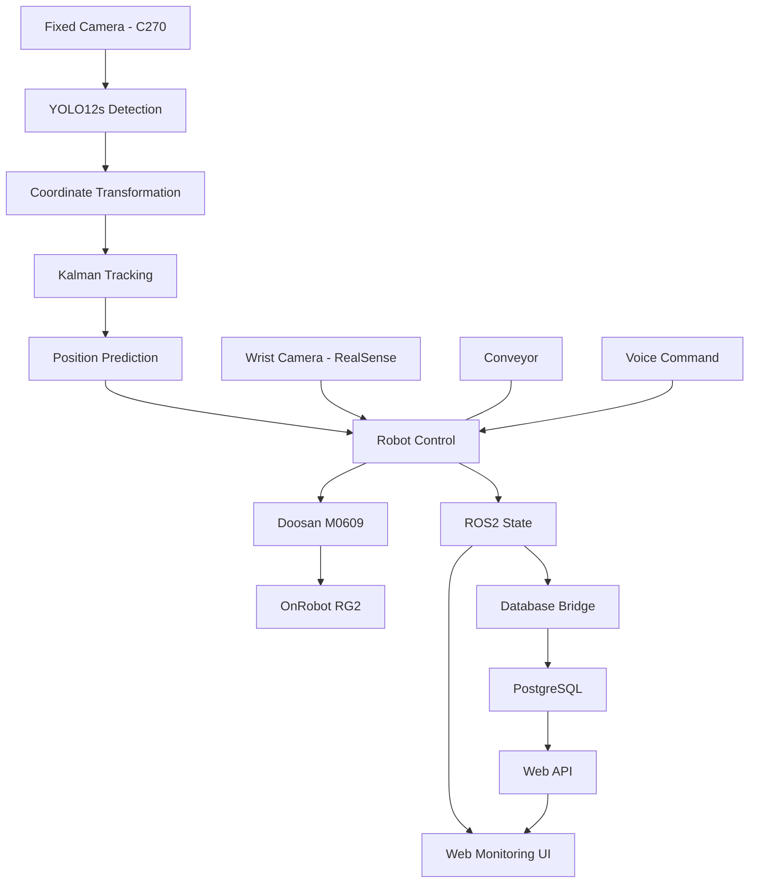

cd "C:\Users\rnfod\Downloads\Rocycle-main"

& {
    $ErrorActionPreference = "Stop"

    $root = (Get-Location).Path
    $source = Join-Path $root "Rocycle-main"
    $final = Join-Path $source "Final"
    $output = Join-Path $root "README.md"

    if (-not (Test-Path $source)) {
        throw "Rocycle-main folder not found."
    }

    function Get-RepoLink {
        param([string]$Path)

        $relative = $Path.Substring(
            $root.Length + 1
        ).Replace('\', '/')

        return (($relative.Split('/') |
            ForEach-Object {
                [Uri]::EscapeDataString($_)
            }) -join '/')
    }

    # ==========================================
    # 01. 기존 README 백업
    # ==========================================

    if (Test-Path $output) {
        $backup = Join-Path $env:TEMP (
            "Rocycle_README_" +
            (Get-Date -Format "yyyyMMdd_HHmmss") +
            ".md"
        )

        Copy-Item $output $backup
        Write-Host "Backup: $backup"
    }

    # ==========================================
    # 02. 개발 문서 수집
    # ==========================================

    $files = @(Get-ChildItem `
        -LiteralPath $source -Recurse -File |
        Where-Object {
            $_.Name -eq "README.md" -or
            (
                $_.Extension -match '^\.(md|txt)$' -and
                $_.FullName -match '[\\/](docs|handover|web_ui)[\\/]'
            )
        } |
        Sort-Object FullName)

    $documents = @(
        foreach ($file in $files) {

            $content = Get-Content `
                -LiteralPath $file.FullName `
                -Raw -Encoding UTF8

            if ($null -eq $content) {
                $content = ""
            }

            $days = @(
                [regex]::Matches(
                    $file.Name + "`n" + $content,
                    '(?<!\d)([1-9])\s*일\s*차'
                ) |
                ForEach-Object {
                    [int]$_.Groups[1].Value
                } |
                Sort-Object -Unique
            )

            [PSCustomObject]@{
                Name = $file.Name
                Path = $file.FullName
                Link = Get-RepoLink $file.FullName
                Content = $content
                Days = $days
                IsFinal = $file.FullName.StartsWith(
                    $final + "\",
                    [StringComparison]::OrdinalIgnoreCase
                )
            }
        }
    )

    $readme = New-Object System.Text.StringBuilder

    function Add-Line {
        param([string]$Text = "")
        [void]$readme.AppendLine($Text)
    }

    # ==========================================
    # 03. 프로젝트 표지
    # ==========================================

    Add-Line @'
<div align="center">

# ♻️ ROCYCLE

### AI-Based Recycling Sorting Robot

**ROKEY Collaboration Project 2**

AI 기반 재활용품 자동 분류 협동로봇 시스템


</div>

---

## 01. Project Overview

Rocycle은 카메라 기반 객체 검출, 위치 추적 및 예측,
협동로봇 제어, 컨베이어, 음성 명령, 웹 관제 시스템을
결합한 재활용품 자동 분류 프로젝트입니다.

| Category | Technology |
|---|---|
| Robot | Doosan M0609 |
| Gripper | OnRobot RG2 |
| Fixed Camera | Logitech C270 |
| Wrist Camera | Intel RealSense |
| Object Detection | YOLO12s |
| Tracking | Kalman Filter |
| Middleware | ROS2 Jazzy |
| Vision | OpenCV |
| Frontend | HTML / CSS / JavaScript |
| Database | PostgreSQL |
| Environment | Python / Docker |

---

## 02. System Architecture

아래는 주요 구성 요소의 개념적 관계도입니다.
실제 ROS2 Topic 및 Service의 상세 명세는 원본 설계 문서를 참고합니다.



---

## 03. Development Timeline

> 개발 일차는 문서 내부의 명시적 기록을 기준으로 분류합니다.
> 여러 일차를 언급한 문서는 해당 일차에 각각 연결됩니다.
> 날짜가 확인되지 않은 자료는 별도로 보존합니다.

'@

    # ==========================================
    # 04. 일차별 목차
    # ==========================================

    Add-Line "| Development Day | Related Documents |"
    Add-Line "|---|---:|"

    foreach ($day in 1..9) {

        $matched = @(
            $documents |
            Where-Object {
                -not $_.IsFinal -and
                $_.Days -contains $day
            }
        )

        Add-Line "| [Day $day](#day-$day) | $($matched.Count) |"
    }

    Add-Line "| [Final](#final) | 최종 구현 |"
    Add-Line "| [YOLO Performance](#yolo-performance) | 모델 검증 |"
    Add-Line "| [Original Documentation](#original-documentation) | 전체 원문 |"
    Add-Line

    # ==========================================
    # 05. 원본 문서 식별 번호
    # ==========================================

    $docIndex = @{}

    for ($i = 0; $i -lt $documents.Count; $i++) {
        $docIndex[$documents[$i].Path] = $i + 1
    }

    # ==========================================
    # 06. 일차별 개발 기록
    # ==========================================

    foreach ($day in 1..9) {

        Add-Line "---"
        Add-Line
        Add-Line "## Day $day"
        Add-Line

        $matched = @(
            $documents |
            Where-Object {
                -not $_.IsFinal -and
                $_.Days -contains $day
            }
        )

        if ($matched.Count -eq 0) {

            Add-Line "> 해당 일차를 명시한 문서를 찾지 못했습니다."
            Add-Line "> 실제 개발 기록이 없다는 의미는 아닙니다."
            Add-Line

            continue
        }

        Add-Line "### Development Records"
        Add-Line

        foreach ($doc in $matched) {

            $id = $docIndex[$doc.Path]

            Add-Line "#### $($doc.Name)"
            Add-Line
            Add-Line "- [Original File]($($doc.Link))"
            Add-Line "- [Full Document](#document-$id)"
            Add-Line

            $lines = @($doc.Content -split '\r?\n')
            $selected = New-Object `
                'System.Collections.Generic.HashSet[int]'

            for ($i = 0; $i -lt $lines.Count; $i++) {

                if ($lines[$i] -match "(?<!\d)$day\s*일\s*차") {

                    $start = [Math]::Max(0, $i - 2)
                    $end = [Math]::Min(
                        $lines.Count - 1,
                        $i + 12
                    )

                    for ($j = $start; $j -le $end; $j++) {
                        [void]$selected.Add($j)
                    }
                }
            }

            if ($selected.Count -gt 0) {

                Add-Line "<details>"
                Add-Line "<summary>해당 일차 관련 원문 발췌</summary>"
                Add-Line

                $excerpt = @(
                    foreach ($j in ($selected | Sort-Object)) {
                        "L$($j + 1): $($lines[$j])"
                    }
                ) -join "`n"

                Add-Line "<pre>"
                Add-Line (
                    [System.Net.WebUtility]::HtmlEncode(
                        $excerpt
                    )
                )
                Add-Line "</pre>"
                Add-Line
                Add-Line "</details>"
                Add-Line
            }
        }

        # 9일차에 YOLO V6 변경 기록 연결

        if ($day -eq 9) {

            Add-Line "### YOLO12s Ver6"
            Add-Line
            Add-Line "9일차 문서에는 클래스 변경 및 파지 설정 개선이 기록되어 있습니다."
            Add-Line
            Add-Line "[YOLO 학습 및 검증 결과](#yolo-performance)"
            Add-Line
        }
    }

    # ==========================================
    # 07. Final
    # ==========================================

    Add-Line @'
---

## Final

### Final System

최종 구현 파일과 개발 문서를 연결합니다.

| Component | Source |
|---|---|
| ROS2 Robot Package | [rocycle_robot](Rocycle-main/Final/rocycle_robot) |
| Configuration | [config](Rocycle-main/Final/config) |
| Calibration | [calib_capture](Rocycle-main/Final/calib_capture) |
| Web Monitoring | [web_ui](Rocycle-main/Final/web_ui) |
| Web API | [web_api](Rocycle-main/Final/web_api) |
| YOLO Models | [models](Rocycle-main/Final/models) |
| Docker | [docker](Rocycle-main/Final/docker) |
| Tests | [test](Rocycle-main/Final/test) |
| Design Documents | [docs](Rocycle-main/Final/docs) |
| Handover | [handover](Rocycle-main/Final/handover) |

### Final Documentation

'@

    foreach ($doc in ($documents | Where-Object IsFinal)) {

        $id = $docIndex[$doc.Path]

        Add-Line "- [$($doc.Name)]($($doc.Link)) — [Full Document](#document-$id)"
    }

    # ==========================================
    # 08. 실제 로봇 사진
    # ==========================================

    Add-Line
    Add-Line "### Robot Hardware"
    Add-Line

    $photo = Get-ChildItem `
        -LiteralPath $source -Recurse -File |
        Where-Object {
            $_.FullName -match 'setup_photos' -and
            $_.Extension -match '^\.(jpg|jpeg|png|webp)$'
        } |
        Select-Object -First 1

    if ($photo) {

        $photoLink = Get-RepoLink $photo.FullName

        Add-Line ""
        Add-Line
    }

    # ==========================================
    # 09. YOLO 학습 결과
    # ==========================================

    Add-Line @'
---

## YOLO Performance

### YOLO12s Ver6 — Training and Evaluation

모델 학습 결과와 내부 테스트 결과를 원본 자료로 표시합니다.
객체 검출 성능은 실제 로봇 파지 및 분류 성공률과 구분합니다.

'@

    $model = Join-Path $final "models\v6"

    if (-not (Test-Path $model)) {
        $model = Join-Path $source "models\v6"
    }

    if (Test-Path $model) {

        $training = Join-Path $model "results.png"
        $matrix = Join-Path $model "confusion_matrix_conf025.png"

        if (Test-Path $training) {

            $link = Get-RepoLink $training

            Add-Line "### Training Results"
            Add-Line
            Add-Line ""
            Add-Line
            Add-Line "학습 및 검증 Loss, Precision, Recall, mAP 변화."
            Add-Line
        }

        if (Test-Path $matrix) {

            $link = Get-RepoLink $matrix

            Add-Line "### Confusion Matrix"
            Add-Line
            Add-Line ""
            Add-Line

            Add-Line @'
| Class | Correct Detections |
|---|---:|
| battery | 25 |
| can | 48 |
| paper | 34 |
| pet_labeled | 43 |
| plastic | 34 |
| plastic_bag | 29 |
| **Total** | **213** |

위 수치는 제공된 혼동 행렬의 대각선 검출 수치입니다.

'@
        }

        $metrics = Join-Path $model "test_metrics.json"

        if (Test-Path $metrics) {

            Add-Line "### Test Metrics"
            Add-Line
            Add-Line '```json'

            Add-Line (
                Get-Content $metrics -Raw -Encoding UTF8
            )

            Add-Line '```'
            Add-Line
        }

        Add-Line "### Model Artifacts"
        Add-Line

        Add-Line "| File | Size (MB) |"
        Add-Line "|---|---:|"

        foreach ($file in (
            Get-ChildItem $model -Recurse -File
        )) {

            $link = Get-RepoLink $file.FullName
            $size = [Math]::Round($file.Length / 1MB, 3)

            Add-Line "| [$($file.Name)]($link) | $size |"
        }
    }

    # ==========================================
    # 10. 일차 미확인 문서
    # ==========================================

    Add-Line
    Add-Line "---"
    Add-Line
    Add-Line "## Undated Development Records"
    Add-Line

    foreach ($doc in (
        $documents |
        Where-Object {
            -not $_.IsFinal -and
            $_.Days.Count -eq 0
        }
    )) {

        $id = $docIndex[$doc.Path]

        Add-Line "- [$($doc.Name)]($($doc.Link)) — [Full Document](#document-$id)"
    }

    # ==========================================
    # 11. 원본 문서 전문 보존
    # ==========================================

    Add-Line
    Add-Line "---"
    Add-Line
    Add-Line "## Original Documentation"
    Add-Line
    Add-Line "기존 개발 문서의 전체 원문을 보존합니다."
    Add-Line

    $included = 0

    foreach ($doc in $documents) {

        $id = $docIndex[$doc.Path]

        Add-Line "### Document $id"
        Add-Line
        Add-Line "**File:** [$($doc.Name)]($($doc.Link))"
        Add-Line

        Add-Line "<details>"
        Add-Line "<summary>원본 문서 전체 보기</summary>"
        Add-Line
        Add-Line "<pre>"

        Add-Line (
            [System.Net.WebUtility]::HtmlEncode(
                $doc.Content
            )
        )

        Add-Line "</pre>"
        Add-Line
        Add-Line "</details>"
        Add-Line

        $included++
    }

    # ==========================================
    # 12. README 저장
    # ==========================================

    $result = $readme.ToString()

    if ($included -ne $documents.Count) {
        throw "Document count verification failed."
    }

    foreach ($doc in $documents) {

        $encoded = [System.Net.WebUtility]::HtmlEncode(
            $doc.Content
        )

        if (-not $result.Contains($encoded)) {
            throw "Original content missing: $($doc.Path)"
        }
    }

    [System.IO.File]::WriteAllText(
        $output,
        $result,
        [System.Text.UTF8Encoding]::new($false)
    )

    # ==========================================
    # 13. 검증 결과
    # ==========================================

    Write-Host ""
    Write-Host "===================================="
    Write-Host "ROCYCLE README REMAKE"
    Write-Host "===================================="
    Write-Host "Source documents: $($documents.Count)"
    Write-Host "Included documents: $included"
    Write-Host "Original content verification: PASS" `
        -ForegroundColor Green

    foreach ($day in 1..9) {

        $count = @(
            $documents |
            Where-Object {
                -not $_.IsFinal -and
                $_.Days -contains $day
            }
        ).Count

        Write-Host "Day ${day}: $count related documents"
    }

    $bytes = (Get-Item $output).Length

    Write-Host "README size: $bytes bytes"
    Write-Host "Output: $output"

    if ($bytes -gt 500000) {
        Write-Warning "README is large. GitHub may truncate rendering."
    }

    # ==========================================
    # 14. 업로드 전 검토
    # ==========================================

    notepad $output

    $confirm = Read-Host "Upload README to GitHub? (Y/N)"

    if ($confirm -ne "Y") {
        Write-Host "README saved locally."
        return
    }

    # ==========================================
    # 15. GitHub 업로드
    # ==========================================

    git add -- README.md

    if ($LASTEXITCODE -ne 0) {
        throw "Git add failed."
    }

    git diff --cached --quiet -- README.md

    if ($LASTEXITCODE -eq 1) {

        git commit --only `
            -m "Remake Rocycle development timeline Day 1-9 and Final" `
            -- README.md

        if ($LASTEXITCODE -ne 0) {
            throw "Git commit failed."
        }

    } elseif ($LASTEXITCODE -ne 0) {
        throw "Git diff failed."
    }

    git push origin main

    if ($LASTEXITCODE -ne 0) {
        throw "Git push failed."
    }

    gh repo view gmltjd0725-hue/yolo-main --web

    Write-Host "README upload completed." `
        -ForegroundColor Green
}
