cd "C:\Users\rnfod\Downloads\Rocycle-main"

$ErrorActionPreference = "Stop"

$readme = @'
<div align="center">

# ♻️ ROCYCLE

### AI-Based Recycling Sorting Robot

**AI 기반 재활용품 자동 분류 협동로봇 시스템**

ROKEY Collaboration Project 2


[Final System](Rocycle-main/Final) |
[Development Records](Rocycle-main/Final/docs) |
[YOLO Model](Rocycle-main/Final/models/v6)

</div>

---

## 📌 Project Overview

컨베이어 위에서 이동하는 재활용품을 실시간으로 검출하고,
좌표 변환과 위치 예측을 통해 협동로봇이 자동으로 파지 및
분류하는 시스템입니다.

객체 검출, 동적 추적, 로봇 제어, 무게 측정,
음성 제어, 웹 관제 및 데이터베이스를 통합했습니다.

## System Architecture

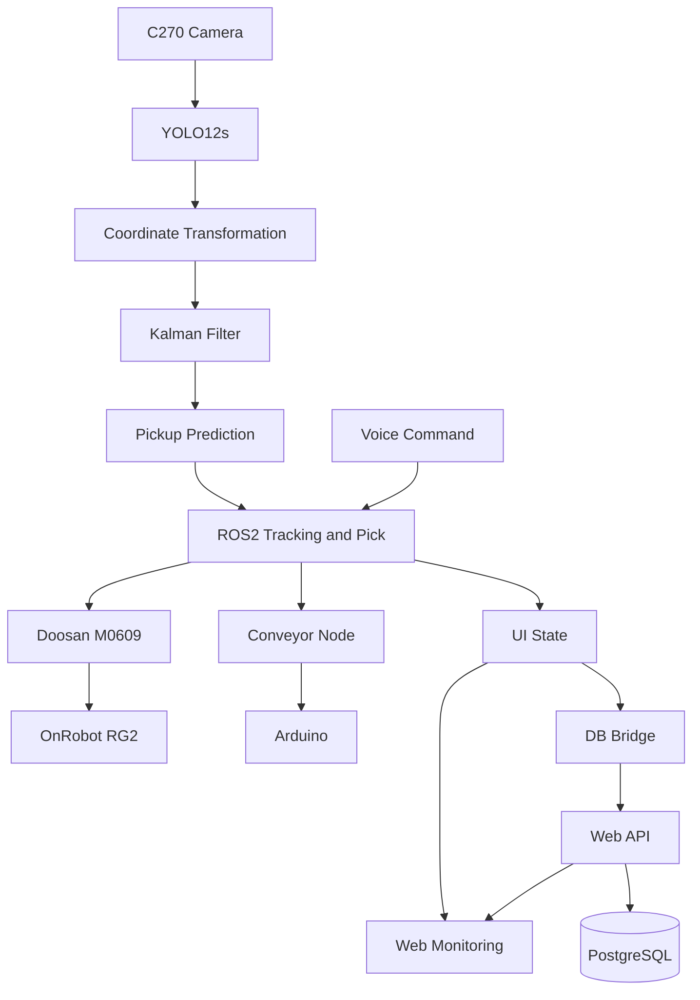

## Hardware & Software

| Category | Technology |
|---|---|
| Robot | Doosan M0609 |
| Gripper | OnRobot RG2 |
| Fixed Camera | Logitech C270 |
| Wrist Camera | Intel RealSense |
| Object Detection | YOLO12s |
| Object Tracking | Kalman Filter |
| Robot Middleware | ROS2 Jazzy |
| Computer Vision | OpenCV |
| Conveyor Control | Arduino |
| Web Interface | HTML / CSS / JavaScript |
| Database | PostgreSQL |
| Development | Python / Docker |

---

## 📅 Development Timeline

| Day | Development |
|---|---|
| [Day 1](#day-1) | 그리퍼 제어 및 통신 |
| [Day 2](#day-2) | 컨베이어 제어 및 카메라 설정 |
| [Day 3](#day-3) | 캘리브레이션 및 좌표 보정 |
| [Day 4](#day-4) | 재질별 파지력 및 분류 조건 |
| [Day 5](#day-5) | 로봇 이동 및 파지 타이밍 |
| [Day 6](#day-6) | YOLO 통합 및 동적 추적 |
| [Day 7](#day-7) | 음성 제어 및 컨베이어 연동 |
| [Day 8](#day-8) | 웹 관제 및 핸드오버 개선 |
| [Day 9](#day-9) | YOLO V6 및 최종 보완 |
| [Final](#final) | 최종 시스템 |

---

## Day 1

### Gripper Control & Communication

OnRobot RG2 그리퍼의 개폐, 파지력 및 상태 조회를
로봇 시스템에서 제어하기 위한 초기 개발을 진행했습니다.

#### Development

- 그리퍼 개폐 제어
- 파지력 설정
- 실제 개방폭 조회
- Modbus 통신 호환성 확인
- ROS2 서비스 연동

#### Troubleshooting

pymodbus 3.10 이후 레지스터 호출 방식 변경으로
기존 래퍼와의 호환성 문제가 발생했습니다.

pymodbus 3.10 미만 환경을 사용하도록 조정했습니다.

[실측 기록 원본](Rocycle-main/Final/docs/실측기록.md)

---

## Day 2

### Conveyor Control

Arduino 시리얼 통신을 기반으로 컨베이어 구동과
정지 기능을 구성했습니다.

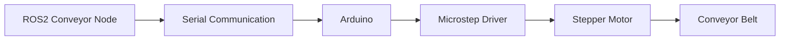

#### Development

- Arduino 시리얼 통신
- 컨베이어 구동 및 정지
- 스테퍼 모터 속도 제어
- 고정 카메라 내부 파라미터 측정
- 관제 PC와 로봇 PC의 역할 분리 설계

#### Camera Configuration

| Parameter | Value |
|---|---:|
| Resolution | 1280 x 720 |
| fx | 1427.528 |
| fy | 1429.802 |
| cx | 674.333 |
| cy | 359.179 |
| MJPEG | 30 FPS |
| YUYV | 7.5 FPS |

[컨베이어 소스코드](Rocycle-main/Final/rocycle_robot/conveyor_node.py)

[실측 기록 원본](Rocycle-main/Final/docs/실측기록.md)

---

## Day 3

### Camera Calibration & Coordinate Transformation

고정 카메라의 픽셀 좌표를 실제 로봇 좌표로
변환하기 위한 캘리브레이션을 진행했습니다.

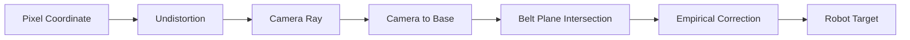

#### Problem

초기 펜 마킹 실측에서 87~230mm의 오차가 발생했습니다.

#### Root Cause

- 기존 AX=XB 솔버 오류
- 캘리브레이션 깊이 방향 다양성 부족
- 체커보드 마운팅 재현성 문제

#### Solution

- OpenCV calibrateHandEye 적용
- 벨트 평면 실측
- 5개 실측 지점 기반 유사변환 보정
- 구조물 높이 제한 모델 도입

#### Verification

| Metric | Result |
|---|---:|
| Belt Plane Maximum Residual | 0.334mm |
| Correction RMS | 4.5mm |
| Maximum Residual | 8.6mm |
| Additional Random Tests | 0~4mm |

보정 결과는 해당 벨트 평면에 한정됩니다.

[Calibration](Rocycle-main/Final/calib_capture)

[Belt Correction](Rocycle-main/Final/rocycle_robot/geometry/belt_correction.py)

[Plane Intersection](Rocycle-main/Final/rocycle_robot/geometry/plane_intersection.py)

---

## Day 4

### Material-Based Grasping

재활용품의 재질에 따라 적절한 파지력과
접근 높이가 다르다는 점을 실물 시험으로 확인했습니다.

#### Development

- 재질별 파지력 설정
- 파지 높이 측정
- 그리퍼 비동기 동작 분석
- 분류 클래스 변경
- 캔 무게 측정 방식 설계

#### Troubleshooting

기본 파지력으로 종이 상자를 파지할 때
모서리가 찌그러지는 문제가 발생했습니다.

재질에 따라 파지력을 낮추고 접근 높이를
조정하는 방향으로 개선했습니다.

[Gripper Profiles](Rocycle-main/Final/config/gripper_profiles.yaml)

[Item Routing](Rocycle-main/Final/config/item_routing.yaml)

---

## Day 5

### Robot Motion & Pickup Timing

이동하는 재활용품을 파지하기 위해 로봇 이동 시간,
하강 시간 및 그리퍼 닫힘 시간을 분석했습니다.

#### Development

- 수평 이동 시간 측정
- 수직 하강 시간 측정
- 그리퍼 자기 정렬 특성 분석
- 벨트 진행 방향 위치 오차 분석
- 관절 특이점 조사

평행 그리퍼는 닫힘 방향의 위치 오차를 일부 흡수할 수
있지만 벨트 진행 방향의 오차는 동일하게 보정하지 못합니다.

따라서 이동 물체의 속도와 로봇 동작 시간을 함께
고려하는 예측 파지 방식이 필요했습니다.

[Motion Timing](Rocycle-main/Final/config/motion_timing.yaml)

[Pickup Timing](Rocycle-main/Final/rocycle_robot/geometry/pickup_timing.py)

---

## Day 6

### YOLO12s Integration

수동 이미지 판단 방식은 이동 물체의 실시간 파지에
필요한 응답 속도를 충족하지 못했습니다.

YOLO12s 모델을 연결하여 실시간 객체 검출 결과를
좌표 변환 및 추적 시스템에 전달하도록 구성했습니다.

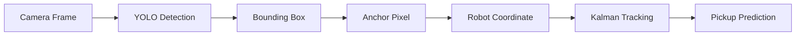

#### Detection Interface

```python
from detector import RecycleDetector

detector = RecycleDetector(
    "models/yolo12s_best.pt",
    conf=0.25
)

detection = detector.detect(frame)

if detection is not None:
    print(detection.class_name)
    print(detection.confidence)
    print(detection.bbox)
    print(detection.anchor_pixel)
```

팀 전달용 인터페이스 사용 예시이며 실제 운영 임계값은
별도 설정을 따릅니다.

### Motion Optimization

| Metric | Before | After |
|---|---:|---:|
| Horizontal Motion | 5.700s | 3.410s |
| Vertical Motion | 4.501s | 2.186s |
| Unloaded Cycle Lower Bound | 38.891s | 20.8s |

사이클 시간은 객체 검출 및 전체 운영 지연을 제외한
무부하 동작 기준입니다.

### Weight Measurement

캔의 외관만으로 내부 내용물 유무를 판단하기 어려워
파지 전후 무게 차이를 이용하는 방식을 적용했습니다.

| Test Object | Measured Weight |
|---|---:|
| Empty Can | 16.3g |
| Can with Contents | 86.9g |

후속 실측에서 baseline 불안정 문제가 확인되어
최종 운영 임계값은 별도로 검증해야 합니다.

### Troubleshooting

- NumPy 2.x와 cv_bridge 호환성 충돌
- CPU 추론 속도 부족
- 미학습 물체 오검출
- 무라벨 PET 오분류
- 무게 측정 서비스 타임아웃
- 파지 준비 시간의 위치 예측 누락
- 다중 물체 순차 처리 문제

[YOLO Integration](Rocycle-main/Final/team_share_yolo12s)

[Kalman Filter](Rocycle-main/Final/rocycle_robot/geometry/kalman_1d.py)

[전체 실측 기록](Rocycle-main/Final/docs/실측기록.md)

---

## Day 7

### Voice Control & Conveyor Integration

음성 명령을 ROS2 상태머신 및 컨베이어 제어와
연동했습니다.

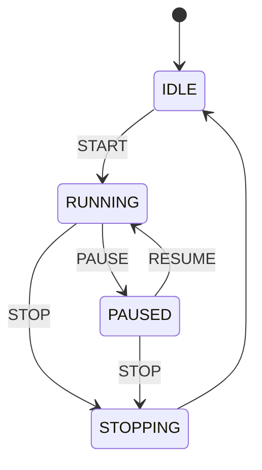

| Command | Function |
|---|---|
| START | 작업 시작 |
| PAUSE | 일시정지 |
| RESUME | 작업 재개 |
| STATUS | 처리 상태 조회 |
| STOP | 작업 종료 |

실제 Arduino와 컨베이어를 연결하여
가동, 정지, 재가동 및 종료를 검증했습니다.

이 시험은 로봇 팔과 카메라를 제외한
상태머신 및 컨베이어 시험입니다.

[Voice Processing](Rocycle-main/Final/rocycle_robot/voice)

[Conveyor Node](Rocycle-main/Final/rocycle_robot/conveyor_node.py)

---

## Day 8

### Web Monitoring System

초기 분할 화면과 별도 상세 화면을
하나의 통합 관제 화면으로 개선했습니다.

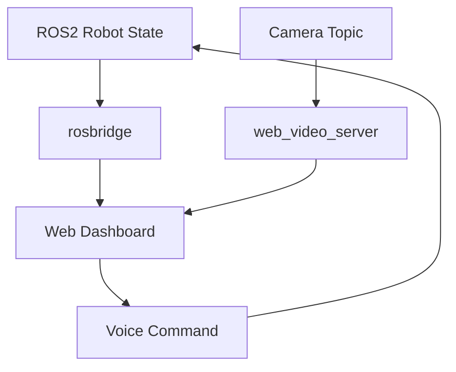

#### Dashboard Functions

| Area | Function |
|---|---|
| Header | 작업 상태 및 경과 시간 |
| Main Camera | 고정 카메라 영상 |
| Wrist Camera | 손목 카메라 영상 |
| Progress | 현재 작업 단계 |
| Statistics | 분류 결과 및 처리 현황 |
| Controls | 시작 / 정지 / 재개 |
| Connection | 장비 연결 상태 |
| Alerts | 오류 및 경고 메시지 |

### Demo Mode

로봇이나 카메라가 없는 환경에서도 UI를
검토할 수 있도록 데모 모드를 구성했습니다.

데모 모드에서는 실제 rosbridge 연결을 생성하지 않습니다.

### Video Streaming Troubleshooting

브라우저에서 ROS2 토픽 경로의 슬래시가
%2F로 인코딩되면서 영상 서버 응답이
끊기는 문제가 발생했습니다.

실제 브라우저 요청과 동일한 조건으로 재현하고
토픽의 슬래시를 유지하도록 인코딩 방식을 변경했습니다.

### Human Handoff

라벨 PET병을 사람에게 전달하는 과정에서
중력에 의한 처짐을 사람의 당김으로 잘못
판단하는 문제가 발생했습니다.

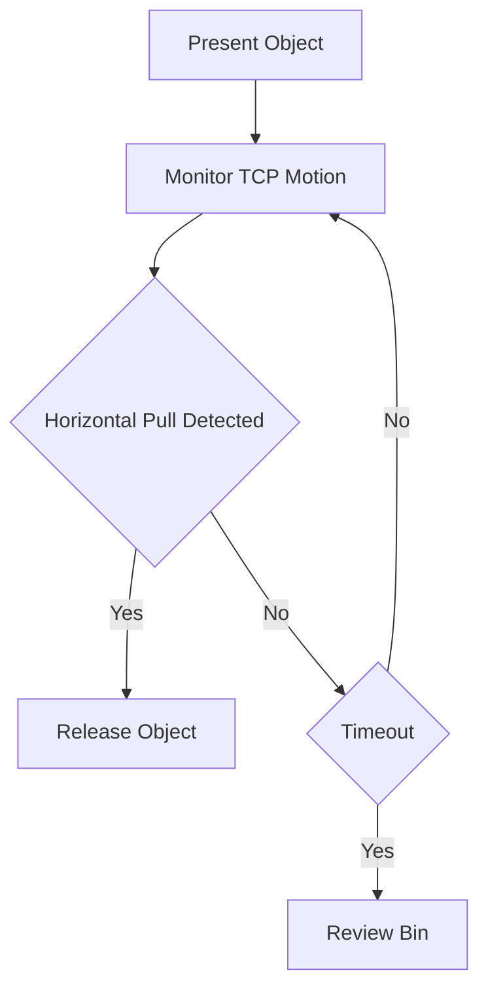

누적 변위뿐 아니라 수평 속도를 함께 확인하도록
판별 방식을 변경했습니다.

무인 실물 시험에서 15.15초 동안 오탐 릴리즈가
발생하지 않은 사례를 확인했습니다.

이후 시험에서도 파라미터 재검토가 진행되었으므로
전체 안전 검증 완료로 판단하지 않습니다.

[Web UI](Rocycle-main/Final/web_ui)

[UI Documentation](Rocycle-main/Final/web_ui/README.md)

[Handoff Logs](Rocycle-main/Final/docs/handoff_logs_20260908)

[Handover](Rocycle-main/Final/handover)

---

## Day 9

### YOLO12s Ver6

무라벨 PET의 오분류 문제와 분류 대상 변경을 반영하여
최종 YOLO12s V6 모델을 구성했습니다.

#### Final Classes

| Class | Destination |
|---|---|
| battery | Battery Bin |
| can | Weight Check |
| paper | Paper Bin |
| pet_labeled | Human Handoff |
| plastic | Plastic Bin |
| plastic_bag | Review Bin |

### Training Configuration

| Parameter | Value |
|---|---|
| Model | YOLO12s |
| Epochs | 50 |
| Image Size | 640 |
| Batch | 8 |
| Seed | 42 |
| Optimizer | AdamW |
| Pretrained | True |

### Model Performance

<div align="center">

| Precision | Recall | mAP50 | mAP50-95 |
|---:|---:|---:|---:|
| **99.67%** | **100%** | **99.50%** | **96.91%** |

</div>

### Training Results

<div align="center">

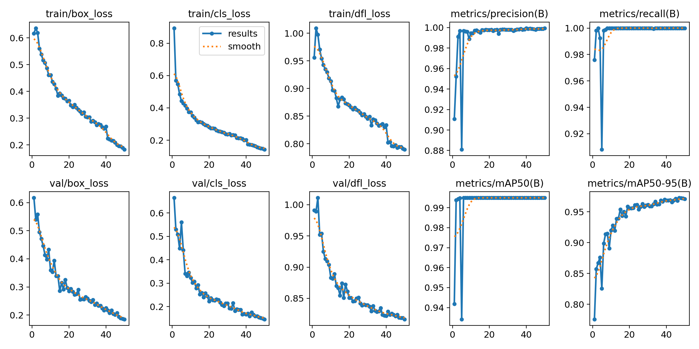

</div>

### Confusion Matrix

<div align="center">

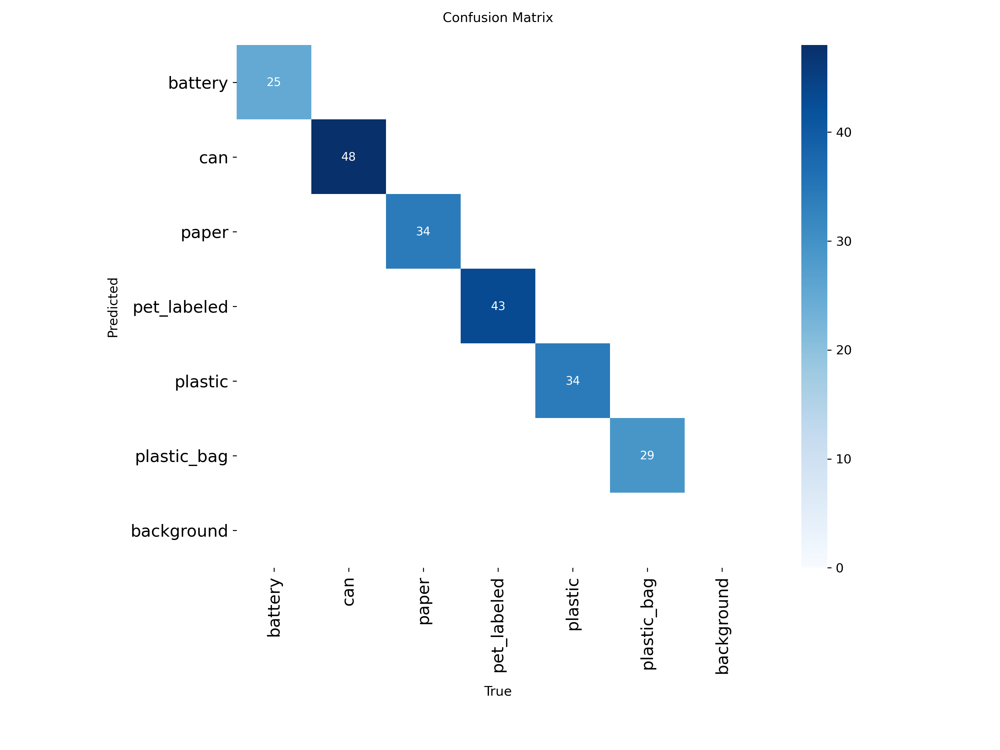

</div>

### Detection Results

| Class | Correct Detections |
|---|---:|
| battery | 25 |
| can | 48 |
| paper | 34 |
| pet_labeled | 43 |
| plastic | 34 |
| plastic_bag | 29 |
| **Total** | **213** |

위 결과는 Roboflow 내부 Test 데이터 기준입니다.
실제 컨베이어 환경의 검출률 및 로봇 파지 성공률과
구분해야 합니다.

### Model Artifacts

| File | Description |
|---|---|
| [yolo12s_best.pt](Rocycle-main/Final/models/v6/yolo12s_best.pt) | 최종 모델 |
| [Training Notebook](Rocycle-main/Final/models/v6/yolo12s_ver6_train_eval_colab.ipynb) | 학습 및 평가 |
| [args.yaml](Rocycle-main/Final/models/v6/args.yaml) | 학습 설정 |
| [results.csv](Rocycle-main/Final/models/v6/results.csv) | Epoch별 지표 |
| [test_metrics.json](Rocycle-main/Final/models/v6/test_metrics.json) | 평가 결과 |
| [dataset_audit.json](Rocycle-main/Final/models/v6/dataset_audit.json) | 데이터셋 검증 |

### Final Troubleshooting

- 그리퍼 서비스 응답 지연
- tracking.yaml 노드 이름 불일치
- Arduino USB 장치 경로 변경
- 플라스틱 파지 프로필 조정
- 컨베이어 실제 속도 재측정
- 로봇 관절 특이점 추가 조사

[Final Model Documentation](Rocycle-main/Final/models/v6/README.md)

[Development Records](Rocycle-main/Final/docs/CLAUDE.md)

---

## Final

### Final System Architecture

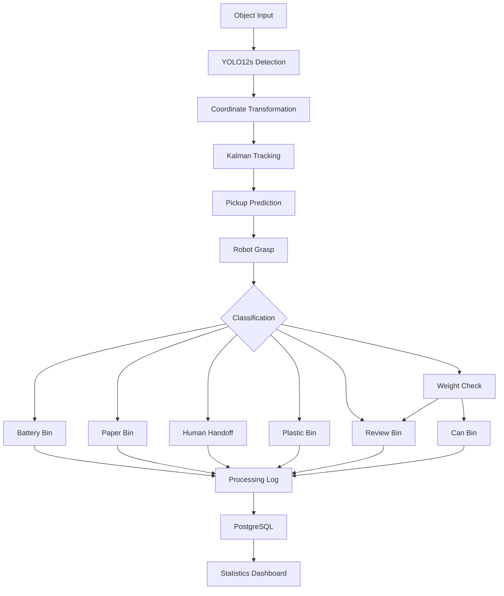

### Database & Web API

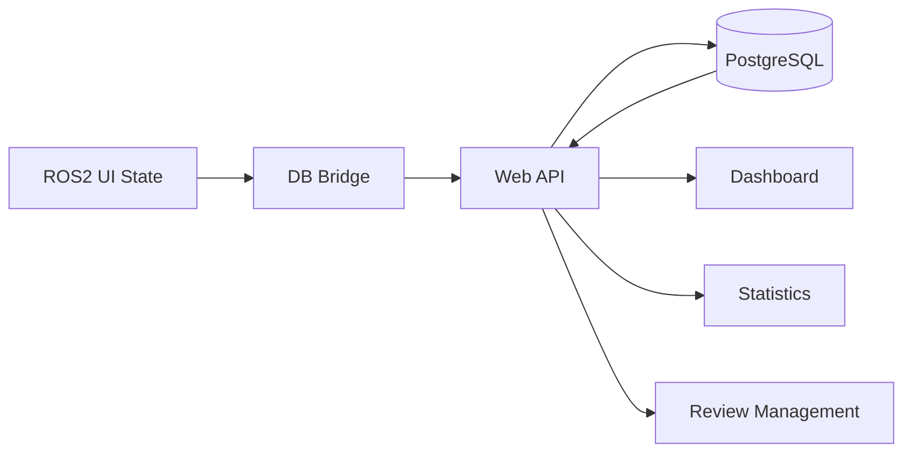

- 처리 결과 저장
- 분류 품목별 통계
- 확인 필요 품목 관리
- 검토 완료 상태 업데이트
- 중복 처리 기록 방지

DB Bridge는 로봇 및 컨베이어 제어 명령을
발행하지 않습니다.

[Web API](Rocycle-main/Final/web_api)

[Database Source](Rocycle-main/Final/web_api/database.py)

[Statistics](Rocycle-main/Final/web_ui/statistics.html)

### Project Structure

```text
Rocycle-main/
└── Final/
    ├── rocycle_robot/
    │   ├── geometry/
    │   ├── vision/
    │   ├── voice/
    │   ├── tracking_node.py
    │   ├── tracking_pick_node.py
    │   ├── conveyor_node.py
    │   └── db_bridge_node.py
    ├── config/
    ├── calib_capture/
    ├── models/
    │   ├── v5/
    │   └── v6/
    ├── web_ui/
    ├── web_api/
    ├── docker/
    ├── test/
    ├── docs/
    └── handover/
```

### Core Source Code

| System | Source |
|---|---|
| Tracking | [tracking_node.py](Rocycle-main/Final/rocycle_robot/tracking_node.py) |
| Robot Pick | [tracking_pick_node.py](Rocycle-main/Final/rocycle_robot/tracking_pick_node.py) |
| Conveyor | [conveyor_node.py](Rocycle-main/Final/rocycle_robot/conveyor_node.py) |
| Kalman Filter | [kalman_1d.py](Rocycle-main/Final/rocycle_robot/geometry/kalman_1d.py) |
| Coordinate Transformation | [plane_intersection.py](Rocycle-main/Final/rocycle_robot/geometry/plane_intersection.py) |
| Calibration Correction | [belt_correction.py](Rocycle-main/Final/rocycle_robot/geometry/belt_correction.py) |
| Pickup Timing | [pickup_timing.py](Rocycle-main/Final/rocycle_robot/geometry/pickup_timing.py) |
| Obstacle Check | [obstacles.py](Rocycle-main/Final/rocycle_robot/geometry/obstacles.py) |
| Web Monitoring | [index.html](Rocycle-main/Final/web_ui/index.html) |
| DB Bridge | [db_bridge_node.py](Rocycle-main/Final/rocycle_robot/db_bridge_node.py) |

### Test & Verification

| Test | Recorded Result |
|---|---|
| Coordinate Correction | RMS 4.5mm |
| Unloaded Cycle Lower Bound | 20.8s |
| YOLO Precision | 99.67% |
| YOLO Recall | 100% |
| YOLO mAP50 | 99.50% |
| YOLO mAP50-95 | 96.91% |
| Voice Conveyor Control | 실물 동작 확인 |
| Handoff | 실물 시험 및 개선 진행 |

### Limitations

- 내부 모델 평가와 실제 로봇 분류 성공률은 다릅니다.
- 다중 물체 순차 처리에는 추가 검증이 필요합니다.
- UI 비상정지의 로봇 즉시 정지는 검증이 필요합니다.
- 컨베이어 속도 및 예측 오차는 실제 환경에서 재확인해야 합니다.
- 테스트 파일의 존재는 전체 테스트 통과를 의미하지 않습니다.

[Test Source Code](Rocycle-main/Final/test)

---

## 📚 Original Documentation

기존 개발 자료 및 원본 소스코드는 그대로 보존합니다.

| Documentation | Link |
|---|---|
| 전체 실측 기록 | [실측기록.md](Rocycle-main/Final/docs/실측기록.md) |
| 개발 원칙 및 정정 이력 | [CLAUDE.md](Rocycle-main/Final/docs/CLAUDE.md) |
| 설계 변경 이력 | [Design History](Rocycle-main/Final/docs/design_history) |
| 인수인계 | [Handover](Rocycle-main/Final/handover) |
| 핸드오버 로그 | [Handoff Logs](Rocycle-main/Final/docs/handoff_logs_20260908) |
| YOLO V6 | [Model Documentation](Rocycle-main/Final/models/v6/README.md) |
| 웹 관제 | [Web UI Documentation](Rocycle-main/Final/web_ui/README.md) |
| 데이터베이스 및 API | [Web API Documentation](Rocycle-main/Final/web_api/README.md) |
| Docker | [Docker Documentation](Rocycle-main/Final/docker/README.md) |
| 기존 프로젝트 | [Original Project](Rocycle-main) |
| 최종 프로젝트 | [Final Project](Rocycle-main/Final) |

---

<div align="center">

### ROCYCLE

**Vision · Robotics · Automation · AI**

ROKEY Collaboration Project 2

</div>
'@

# 저장소 위치 확인

if (-not (Test-Path ".git")) {
    throw "Git repository not found."
}

if (-not (Test-Path "Rocycle-main\Final")) {
    throw "Final project folder not found."
}

# 기존 README 백업

if (Test-Path "README.md") {
    $backup = Join-Path $env:TEMP (
        "Rocycle_README_" +
        (Get-Date -Format "yyyyMMdd_HHmmss") +
        ".md"
    )

    Copy-Item "README.md" $backup

    Write-Host "Backup: $backup"
}

# UTF-8 Markdown 저장

[System.IO.File]::WriteAllText(
    (Join-Path (Get-Location).Path "README.md"),
    $readme,
    [System.Text.UTF8Encoding]::new($false)
)

# GitHub 업로드

git add -- README.md

if ($LASTEXITCODE -ne 0) {
    throw "Git add failed."
}

git commit --only -m "Remake ROCYCLE project README" -- README.md

if ($LASTEXITCODE -ne 0) {
    throw "Git commit failed."
}

git push origin main

if ($LASTEXITCODE -ne 0) {
    throw "Git push failed."
}

Start-Process "https://github.com/gmltjd0725-hue/yolo-main"

Write-Host "README upload completed." -ForegroundColor Green
