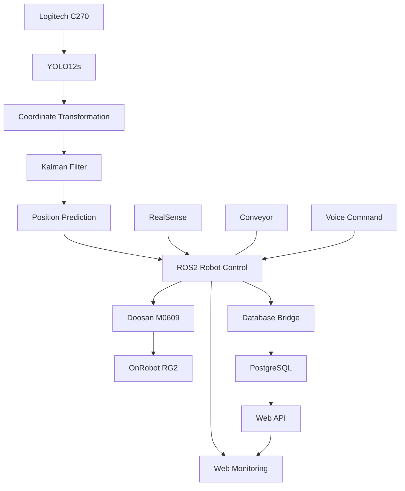

cd "C:\Users\rnfod\Downloads\Rocycle-main"

& {
    $ErrorActionPreference = "Stop"

    $root = (Get-Location).Path
    $source = Join-Path $root "Rocycle-main"
    $final = Join-Path $source "Final"
    $output = Join-Path $root "README.md"

    if (-not (Test-Path $source)) {
        throw "Rocycle-main folder not found."
    }

    # 01. Backup

    if (Test-Path $output) {
        $backup = Join-Path $env:TEMP (
            "Rocycle_README_" +
            (Get-Date -Format "yyyyMMdd_HHmmss") +
            ".md"
        )

        Copy-Item $output $backup
        Write-Host "Backup: $backup"
    }

    # 02. Functions

    function Get-RepoLink {
        param([string]$Path)

        $relative = $Path.Substring(
            $root.Length + 1
        ).Replace('\', '/')

        return (($relative.Split('/') |
            ForEach-Object {
                [Uri]::EscapeDataString($_)
            }) -join '/')
    }

    $builder = New-Object System.Text.StringBuilder

    function Add-Line {
        param([string]$Text = "")
        [void]$builder.AppendLine($Text)
    }

    # 03. Project Cover

    Add-Line @'
# ♻️ ROCYCLE

### AI-Based Recycling Sorting Robot

> ROKEY Collaboration Project 2
>
> AI 기반 재활용품 자동 분류 협동로봇 시스템

---

## Project Overview

카메라 기반 객체 검출, 좌표 변환, 위치 추적 및 예측,
협동로봇 제어, 컨베이어, 음성 명령, 웹 관제를 결합한
재활용품 자동 분류 시스템입니다.

## System Architecture

주요 시스템 구성 요소의 개념적 관계도입니다.

## Hardware and Software

| Category | Technology |
|---|---|
| Robot | Doosan M0609 |
| Gripper | OnRobot RG2 |
| Fixed Camera | Logitech C270 |
| Wrist Camera | Intel RealSense |
| Detection | YOLO12s |
| Tracking | Kalman Filter |
| Middleware | ROS2 Jazzy |
| Vision | OpenCV |
| Frontend | HTML / CSS / JavaScript |
| Database | PostgreSQL |
| Environment | Python / Docker |

---

## Development Timeline

'@

    # 04. Timeline

    foreach ($day in 1..9) {
        Add-Line "- [${day}일차](#day-$day)"
    }

    Add-Line "- [Final](#final)"
    Add-Line "- [Original Documentation](#original-documentation)"
    Add-Line

    # 05. Read Source Documents

    $files = @(Get-ChildItem `
        -LiteralPath $source -Recurse -File |
        Where-Object {
            $_.Extension -match '^\.(md|txt)$'
        } |
        Sort-Object FullName)

    $documents = @(
        foreach ($file in $files) {

            $content = [IO.File]::ReadAllText(
                $file.FullName
            )

            [PSCustomObject]@{
                Name = $file.Name
                Path = $file.FullName
                Link = Get-RepoLink $file.FullName
                Content = $content
                IsFinal = $file.FullName.StartsWith(
                    $final + "\",
                    [StringComparison]::OrdinalIgnoreCase
                )
            }
        }
    )

    # 06. Daily Development Records

    foreach ($day in 1..9) {

        Add-Line "---"
        Add-Line
        Add-Line "## Day $day"
        Add-Line
        Add-Line "### ${day}일차 개발 기록"
        Add-Line

        $pattern = "(?<!\d)$day\s*일\s*차"

        $matched = @(
            $documents |
            Where-Object {
                -not $_.IsFinal -and
                (
                    $_.Content -match $pattern -or
                    $_.Name -match $pattern
                )
            }
        )

        if ($matched.Count -eq 0) {

            Add-Line "> 명시적인 해당 일차 기록을 확인하지 못했습니다."
            Add-Line
        }

        foreach ($doc in $matched) {

            Add-Line "#### $($doc.Name)"
            Add-Line
            Add-Line "[원본 문서 전체 보기]($($doc.Link))"
            Add-Line

            $lines = $doc.Content -split '\r?\n'

            $selected = New-Object `
                'System.Collections.Generic.HashSet[int]'

            for ($i = 0; $i -lt $lines.Count; $i++) {

                if ($lines[$i] -match $pattern) {

                    $start = [Math]::Max(0, $i - 1)

                    $end = [Math]::Min(
                        $lines.Count - 1,
                        $i + 8
                    )

                    for ($j = $start; $j -le $end; $j++) {
                        [void]$selected.Add($j)
                    }
                }
            }

            if ($selected.Count -gt 0) {

                Add-Line "
"
                Add-Line "
관련 개발 기록
"
                Add-Line
                Add-Line "<pre>"

                foreach ($j in ($selected | Sort-Object)) {

                    $line = "L$($j + 1): $($lines[$j])"

                    Add-Line (
                        [Net.WebUtility]::HtmlEncode($line)
                    )
                }

                Add-Line "</pre>"
                Add-Line "
"
                Add-Line
            }
        }

        # YOLO V6

        if ($day -eq 9) {

            Add-Line "### YOLO12s Ver6"
            Add-Line
            Add-Line "9일차 클래스 변경 기록과 관련된 모델 검증 자료입니다."
            Add-Line

            $model = Join-Path $final "models\v6"

            if (-not (Test-Path $model)) {
                $model = Join-Path $source "models\v6"
            }

            $training = Join-Path $model "results.png"
            $matrix = Join-Path $model "confusion_matrix_conf025.png"

            if (Test-Path $training) {

                Add-Line "#### Training Results"
                Add-Line

                Add-Line (
                    " + ")"
                )

                Add-Line
            }

            if (Test-Path $matrix) {

                Add-Line "#### Confusion Matrix"
                Add-Line

                Add-Line (
                    " + ")"
                )

                Add-Line
            }

            Add-Line @'
#### Detection Performance

| Metric | Internal Test Result |
|---|---:|
| Precision | 99.67% |
| Recall | 100% |
| mAP50 | 99.50% |
| mAP50-95 | 96.91% |

#### Confusion Matrix — Correct Detections

| Class | Count |
|---|---:|
| battery | 25 |
| can | 48 |
| paper | 34 |
| pet_labeled | 43 |
| plastic | 34 |
| plastic_bag | 29 |
| **Total** | **213** |

객체 검출 내부 테스트 결과이며,
실제 로봇의 파지 및 분류 성공률과는 구분합니다.

'@

            if (Test-Path $model) {

                Add-Line "#### Model Artifacts"
                Add-Line

                foreach ($file in (
                    Get-ChildItem $model -Recurse -File
                )) {

                    $link = Get-RepoLink $file.FullName

                    Add-Line "- [$($file.Name)]($link)"
                }
            }

            Add-Line
        }

        Write-Host "Day ${day}: $($matched.Count) related documents"
    }

    # 07. Final

    Add-Line @'
---

## Final

### Final System Implementation

| Component | Source |
|---|---|
| ROS2 Robot Package | [rocycle_robot](Rocycle-main/Final/rocycle_robot) |
| Configuration | [config](Rocycle-main/Final/config) |
| Calibration | [calib_capture](Rocycle-main/Final/calib_capture) |
| Web Monitoring | [web_ui](Rocycle-main/Final/web_ui) |
| Web API | [web_api](Rocycle-main/Final/web_api) |
| YOLO Models | [models](Rocycle-main/Final/models) |
| Docker | [docker](Rocycle-main/Final/docker) |
| Tests | [test](Rocycle-main/Final/test) |
| Design Documents | [docs](Rocycle-main/Final/docs) |
| Handover | [handover](Rocycle-main/Final/handover) |

### Robot Hardware

'@

    $photos = @(Get-ChildItem `
        -LiteralPath $source -Recurse -File |
        Where-Object {
            $_.FullName -match 'setup_photos' -and
            $_.Extension -match '^\.(jpg|jpeg|png|webp)$'
        })

    if ($photos.Count -gt 0) {

        $photo = $photos[0]

        Add-Line (
            " + ")"
        )

        Add-Line
    }

    # 08. Final Test Files

    Add-Line "### Test and Verification"
    Add-Line

    $testPath = Join-Path $final "test"

    if (Test-Path $testPath) {

        foreach ($file in (
            Get-ChildItem $testPath -File -Filter "*.py"
        )) {

            $link = Get-RepoLink $file.FullName

            Add-Line "- [$($file.Name)]($link)"
        }
    }

    Add-Line
    Add-Line "### Final Documentation"
    Add-Line

    foreach ($doc in (
        $documents | Where-Object IsFinal
    )) {

        Add-Line "- [$($doc.Name)]($($doc.Link))"
    }

    # 09. All Original Documents

    Add-Line
    Add-Line "---"
    Add-Line
    Add-Line "## Original Documentation"
    Add-Line

    Add-Line "기존 원본 문서는 수정하거나 삭제하지 않습니다."
    Add-Line
    Add-Line "| No. | Original Document |"
    Add-Line "|---:|---|"

    $index = 0

    foreach ($doc in $documents) {

        $index++

        $relative = $doc.Path.Substring(
            $root.Length + 1
        ).Replace('\', '/')

        Add-Line "| $index | [$relative]($($doc.Link)) |"
    }

    # 10. Save README

    $result = $builder.ToString()

    [IO.File]::WriteAllText(
        $output,
        $result,
        [Text.UTF8Encoding]::new($false)
    )

    Write-Host ""
    Write-Host "===================================="
    Write-Host "ROCYCLE README REMAKE"
    Write-Host "===================================="
    Write-Host "Original documents: $($documents.Count)"
    Write-Host "README size: $((Get-Item $output).Length) bytes"
    Write-Host "Output: $output"

    # 11. Review

    notepad $output

    $confirm = Read-Host "Upload README? (Y/N)"

    if ($confirm -ne "Y") {
        Write-Host "README saved locally."
        return
    }

    # 12. GitHub Upload

    git add -- README.md

    if ($LASTEXITCODE -ne 0) {
        throw "Git add failed."
    }

    git diff --cached --quiet -- README.md

    $diffCode = $LASTEXITCODE

    if ($diffCode -eq 1) {

        git commit --only `
            -m "Remake Rocycle Day 1-9 and Final README" `
            -- README.md

        if ($LASTEXITCODE -ne 0) {
            throw "Git commit failed."
        }

    } elseif ($diffCode -ne 0) {

        throw "Git diff failed."
    }

    git push origin main

    if ($LASTEXITCODE -ne 0) {
        throw "Git push failed."
    }

    Start-Process "https://github.com/gmltjd0725-hue/yolo-main"

    Write-Host "README upload completed." `
        -ForegroundColor Green
}
